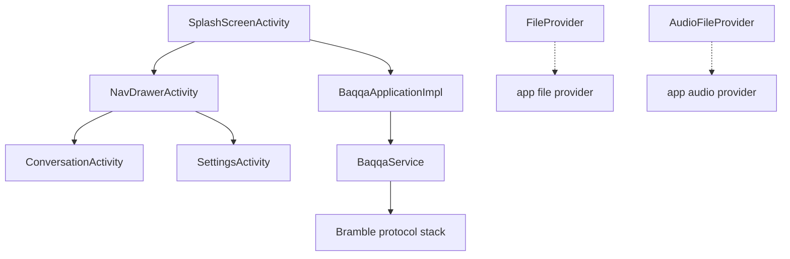

# Architecture

## Module structure

Baqqa is a multi-module Gradle project. Modules declared in `settings.gradle`:

| Module | Role |
|--------|------|
| `:baqqa-android` | Android application (entry point: `SplashScreenActivity`) |
| `:baqqa-core` | Baqqa core implementation |
| `:baqqa-api` | Baqqa public API / interfaces |
| `:baqqa-headless` | Baqqa headless (desktop) implementation |
| `:bramble-android` | Bramble protocol stack — Android |
| `:bramble-core` | Bramble protocol stack — core |
| `:bramble-api` | Bramble public API / interfaces |
| `:bramble-java` | Bramble protocol stack — Desktop & Headless |
| `:mailbox-core`, `:mailbox-lib`, `:mailbox-integration-tests` | Optional mailbox integration tests (conditionally included) |

## Data / control flow (supported by source)

* Application entry: `org.Baqqaproject.Baqqa.android.splash.SplashScreenActivity` (`MAIN` + `LAUNCHER`, `exported="true"`), then `NavDrawerActivity`.
* Application class: `org.Baqqaproject.Baqqa.android.BaqqaApplicationImpl`.
* Background service: `org.Baqqaproject.Baqqa.android.BaqqaService` (`exported="false"`).
* File sharing: `FileProvider` (`${applicationId}.fileprovider`) and `AudioFileProvider` (`${applicationId}.audioprovider`), both `exported="false"`.
* Dependencies flow from `:baqqa-android` → `:baqqa-core` → `:bramble-core`/`:bramble-android`; tests depend on `:bramble-api`/`:bramble-core` test output.

## Diagram

Each connection above corresponds to a declared activity/service/provider or Gradle dependency in the source. No connections are invented.

## Limitations

* This is a static, source-observable description; runtime behaviour has not been verified because the app has not been built or launched.
* No sequence or class diagrams are included, as they cannot be verified without execution.
